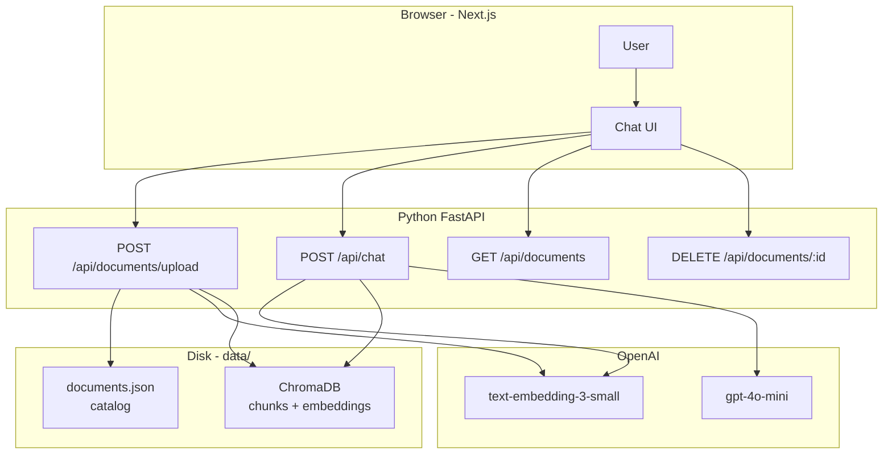
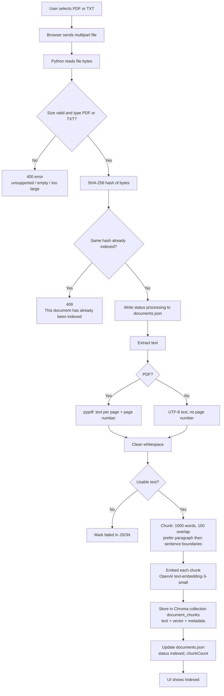
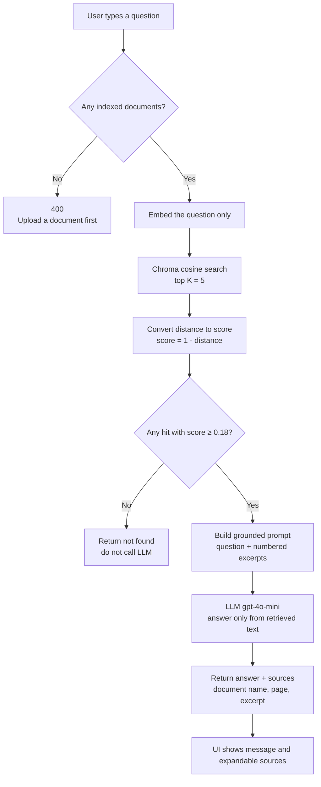
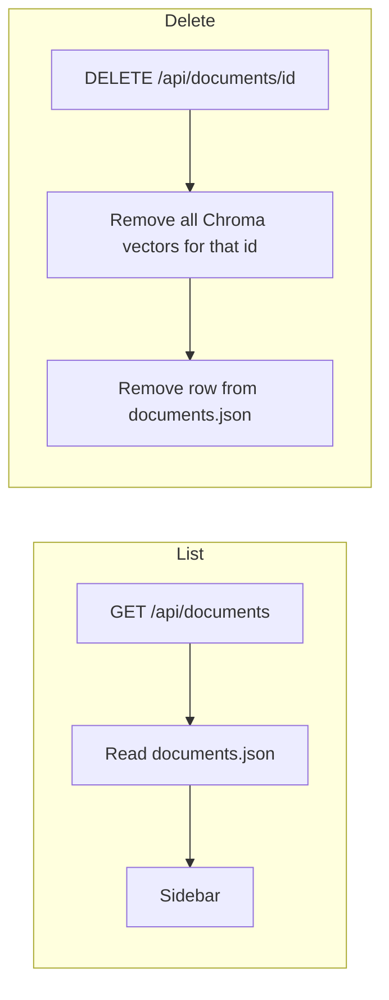

# Workflow and Flowcharts

This document describes how the RAG Assistant moves data from an uploaded file to a grounded answer.

**Stack**

- UI: Next.js (`components/ChatApp.tsx`) at http://localhost:3000
- API: Python FastAPI (`backend/app.py`) at http://localhost:8000
- Pipeline: `backend/rag.py`
- Next.js rewrites `/api/*` to the Python server

Knowledge exists only after a user uploads a PDF or TXT. Nothing is hardcoded.

---

## End-to-end picture



Two rules:

1. **Upload time** is when the document is extracted, chunked, embedded, and stored.
2. **Question time** only embeds the question, searches stored vectors, and calls the LLM. The original file is not read again.

---

## Workflow A — Document ingestion

Triggered by **+ Upload** in the sidebar. Route: `POST /api/documents/upload` → `ingest_file()`.



### Step by step

| Step | What happens | Code |
| --- | --- | --- |
| 1 | File is sent from the browser | `ChatApp` → `POST /api/documents/upload` |
| 2 | Type is detected from **bytes** (`%PDF` or UTF-8 `.txt`), not the filename | `detect_type()` |
| 3 | SHA-256 identifies exact duplicates | `sha256_bytes()` |
| 4 | Text is extracted. PDFs keep page numbers | `extract_pages()` |
| 5 | Text is split with overlap | `chunk_text()` / `chunk_pages()` |
| 6 | Each chunk is embedded (1536 numbers) | Chroma + OpenAI embedding function |
| 7 | Vectors and chunk text are written to disk | `data/chroma/` |
| 8 | Catalog row is updated | `data/documents.json` |

The original file is **not** saved. After this workflow, only chunks + embeddings + metadata remain.

### Chunking defaults

Configured in `.env` / `.env.example`:

- `CHUNK_SIZE_WORDS=1000`
- `CHUNK_OVERLAP_WORDS=150`

Split order: paragraphs → newlines → sentences → commas/spaces → hard word window.

---

## Workflow B — Ask a question

Triggered by **Send**. Route: `POST /api/chat` → `answer_question()`.



### Step by step

| Step | What happens | Code |
| --- | --- | --- |
| 1 | Empty question is rejected in the UI and API | `answer_question()` |
| 2 | If no indexed docs, chat is blocked | `indexed_count()` |
| 3 | Only the **question** is embedded | `collection.query(query_texts=...)` |
| 4 | Top 5 nearest chunks across **all** indexed files | `TOP_K=5` |
| 5 | Hits below `MIN_RELEVANCE_SCORE` (0.18) are dropped | `search_chunks()` |
| 6 | If none remain: *No sufficiently relevant information was found...* | no LLM call |
| 7 | Otherwise the LLM sees numbered excerpts and must cite `[n]` | `GROUNDED_SYSTEM_PROMPT` |
| 8 | UI lists sources (name, page for PDFs, short excerpt) | `ChatApp` |

Chat bubbles live in the **browser session**. They are not written to Chroma. Indexed documents **are** on disk and survive restart.

---

## Workflow C — List and delete



Delete removes both catalog and vectors so nothing is left behind.

---

## Where data lives

```text
data/
  documents.json      ← human-readable catalog (sidebar)
  chroma/
    chroma.sqlite3    ← Chroma catalog + embeddings metadata
    <uuid>/           ← vector segment files
```

| Store | Survives refresh / restart | What you can open |
| --- | --- | --- |
| `documents.json` | Yes | Directly in the editor |
| ChromaDB `document_chunks` | Yes | Query with Python or open `chroma.sqlite3` |
| Original PDF/TXT | No | Not kept after ingest |
| Chat history | No | Browser memory only |

Inspect stored chunks:

```bash
cd backend
../.venv/bin/python - <<'PY'
from rag import get_collection
col = get_collection()
got = col.get(include=["documents", "metadatas"])
print("chunks:", col.count())
for cid, text, meta in zip(got["ids"], got["documents"], got["metadatas"]):
    print(meta["documentName"], "page", meta.get("pageNumber"), "chunk", meta.get("chunkIndex"))
    print((text or "")[:200], "\n")
PY
```

---

## Combined flowchart

```text
                    ┌─────────────────┐
                    │   User Upload   │
                    └────────┬────────┘
                             ▼
                    ┌─────────────────┐
                    │ Text Extraction │
                    └────────┬────────┘
                             ▼
                    ┌─────────────────┐
                    │    Chunking     │
                    └────────┬────────┘
                             ▼
                    ┌─────────────────┐
                    │   Embeddings    │
                    └────────┬────────┘
                             ▼
                    ┌─────────────────┐
                    │  Vector DB      │
                    │  data/chroma    │
                    └─────────────────┘


User Question
      ▼
Query Embedding
      ▼
Vector Search
      ▼
Relevant Chunks  (score ≥ 0.18)
      ▼
LLM
      ▼
Grounded Answer + Sources
```

---

## API map

| Method | Path | Workflow |
| --- | --- | --- |
| `POST` | `/api/documents/upload` | Ingestion |
| `GET` | `/api/documents` | List catalog |
| `DELETE` | `/api/documents/:id` | Delete catalog + vectors |
| `POST` | `/api/chat` | Retrieve + generate |

Related: [architecture.md](./architecture.md)
